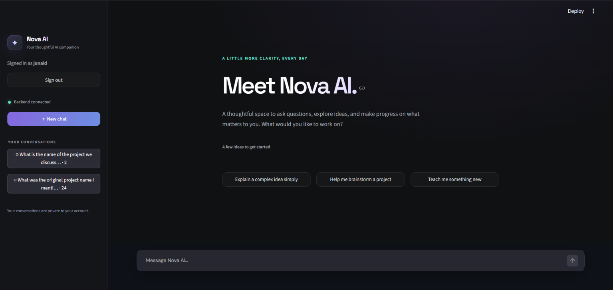

# Nova AI

## Project Overview

Nova AI is an LLM-powered conversational assistant with a FastAPI backend and
a Streamlit frontend. It uses Google's Gemini models, persists conversations
in SQLite, and maintains older conversation context through incremental
summaries.

## Application Preview



*Nova AI — Your thoughtful AI companion.*

## Features

- Dark-themed Streamlit chat interface with conversation history.
- Gemini primary model with automatic fallback for rate-limit and service
  unavailable responses.
- Persistent, multi-turn conversations stored in SQLite.
- Configurable recent-message window and per-conversation running summaries.
- Incremental summary checkpoints and safe concurrent summary updates.
- User registration, login, logout, and private user-owned conversations.
- Mocked automated tests that do not consume Gemini API quota.

## Technology Stack

- Python 3.10+
- FastAPI and Uvicorn for the REST API
- Streamlit for the frontend
- Google Gen AI SDK and Gemini
- SQLite for conversations, messages, summaries, users, and sessions
- bcrypt for password hashing
- pytest and FastAPI's test client for automated testing

## Architecture

- `backend/main.py` exposes API and authentication endpoints and coordinates
  chat requests.
- `backend/llm.py` formats Gemini requests, handles model fallback, and
  redacts API keys from logged errors.
- `backend/context_manager.py` selects recent messages and incrementally
  summarizes older context.
- `backend/database.py` initializes/migrates the SQLite schema and stores
  conversation, summary, account, and session data.
- `backend/auth.py` hashes passwords and manages expiring, revocable sessions.
- `frontend/` contains the Streamlit app, API client, styling, and browser
  token storage component.
- `tests/` contains database, API, context-management, frontend-client, and
  mocked Gemini tests.

## Prerequisites

- Windows with PowerShell (commands below use PowerShell syntax); Python 3.10
  or newer and `pip`.
- A Google Gemini API key for actual AI responses. Automated tests mock Gemini
  and do not require a live API key.

## Installation and Setup

Run these commands from the project root:

```powershell
python -m venv venv
.\venv\Scripts\Activate.ps1
python -m pip install -r requirements.txt
if (-not (Test-Path .env)) { Copy-Item .env.example .env } else { Write-Output ".env already exists; keeping it unchanged." }
```

Set `GEMINI_API_KEY` in your local `.env` file using a text editor. Never
commit `.env`; `.gitignore` excludes it. The checked-in `.env.example` contains
only a safe placeholder.

## Environment Variable Configuration

| Variable | Required | Default | Description |
|---|---|---|---|
| `GEMINI_API_KEY` | Yes for live Gemini calls | — | Gemini API credential; keep it private in `.env`. |
| `GEMINI_MODEL` | No | `gemini-3.5-flash` | Primary model. |
| `GEMINI_FALLBACK_MODEL` | No | `gemini-3.5-flash-lite` | Fallback model for HTTP 429 or 503. |
| `GEMINI_TEMPERATURE` | No | SDK default | Optional generation temperature. |
| `GEMINI_MAX_OUTPUT_TOKENS` | No | SDK default | Optional maximum generated tokens. |
| `MAX_RECENT_MESSAGES` | No | `10` | Positive integer count of recent messages passed directly as context. |
| `NOVA_API_URL` | No | `http://127.0.0.1:8000` | Backend URL used by the Streamlit frontend. |

The backend loads `.env` from the project root. The frontend reads
`NOVA_API_URL` from its process environment.

## Running the Backend

In a PowerShell terminal at the project root:

```powershell
.\venv\Scripts\Activate.ps1
python -m uvicorn backend.main:app --reload
```

The API is available at `http://127.0.0.1:8000`. Health check:
`http://127.0.0.1:8000/health`.

## Running the Frontend

In a second PowerShell terminal at the project root:

```powershell
.\venv\Scripts\Activate.ps1
python -m streamlit run frontend/app.py
```

Open `http://localhost:8501`. For a different backend URL, set
`NOVA_API_URL` before starting Streamlit, for example:

```powershell
$env:NOVA_API_URL = "http://127.0.0.1:8000"
python -m streamlit run frontend/app.py
```

## API Documentation

Interactive OpenAPI documentation is available at
`http://127.0.0.1:8000/docs`.

| Method | Endpoint | Authentication | Purpose |
|---|---|---|---|
| `GET` | `/` | No | Application status. |
| `GET` | `/health` | No | Backend/database health. |
| `POST` | `/auth/register` | No | Register and return an access token. |
| `POST` | `/auth/login` | No | Authenticate and return an access token. |
| `GET` | `/auth/me` | Bearer token | Return the authenticated account. |
| `POST` | `/auth/logout` | Bearer token | Revoke the current session. |
| `POST` | `/chat` | Bearer token | Create a conversation or send a turn. |
| `GET` | `/conversations` | Bearer token | List the authenticated user's conversations. |
| `GET` | `/conversations/{conversation_id}` | Bearer token | Retrieve an owned conversation and its messages. |

Protected calls use `Authorization: Bearer <access_token>`. To create a
conversation, send `conversation_id: null` or omit the field:

```json
{
  "message": "What would you like to work on?",
  "conversation_id": null
}
```

The chat response contains `conversation_id` and `response`. Requests to
unknown or other users' conversation IDs return 404.

## Multi-turn Conversation Memory

For each continuation, the backend loads that conversation's persisted
messages in chronological order. It sends the selected recent messages to
Gemini followed by the current user message. The assistant response and new
user message are stored together only after response generation succeeds.
New conversations and their first successful exchange are persisted
atomically.

## Context Window Management and Summarisation

`MAX_RECENT_MESSAGES` (default `10`) controls how many latest messages are
sent directly. Older unsummarized messages are incrementally summarized with
the prior summary included in the summarization request. The summary is
included in Gemini's system instructions for response generation.

Each conversation stores a summary and `last_summarized_message_id`. Older
messages at or below that checkpoint are not summarized again. Summary text
and checkpoint are updated together with an atomic compare-and-swap; concurrent
updates reload the latest summary/checkpoint and retry instead of overwriting
newer context. A summary is checked for non-empty output and retention of
meaningful prior/new terms before replacing the stored summary.

Existing databases whose summaries predate checkpoint tracking are migrated
without deleting messages or summaries. Since their exact prior coverage
cannot be inferred, their checkpoint is initialized to zero and those
messages may be summarized again rather than advancing the checkpoint based
on a guess.

## Error Handling

- Empty chat messages return HTTP 400.
- Unknown or unowned conversations return HTTP 404 without exposing their
  contents.
- Gemini failures are returned as a generic HTTP 502; database availability
  failures return HTTP 503.
- Gemini retries with the fallback model on HTTP 429 and 503. Other provider
  errors, including timeout/invalid-key responses, fail safely without
  returning provider details to the client.
- Failed generations do not persist a new user/assistant exchange.
- The frontend displays user-facing errors and connection problems.

## Authentication and Conversation Privacy

Passwords are hashed with bcrypt. Login returns an opaque bearer token whose
digest—not the token itself—is stored in SQLite. Sessions expire after seven
days and are revoked on logout. The frontend stores the token in browser local
storage to persist login across refreshes.

The API derives identity from the verified session and scopes conversation
listing, retrieval, and writes to that user. It does not trust a client-supplied
user ID. Existing legacy conversations remain unowned after migration and are
not shown to newly registered accounts. Use HTTPS and an appropriately
hardened deployment before exposing the service beyond localhost.

## Running Tests

From the project root, activate the virtual environment and run:

```powershell
.\venv\Scripts\Activate.ps1
python -m pytest -q
```

The automated suite uses mocked Gemini responses and temporary SQLite
databases; it does not make live Gemini requests.

## Test Results

Previously recorded result: **42 passed**, with **one existing Starlette/httpx
deprecation warning**. This is a historical result, not a new test run for
this documentation/configuration update. A separate final verification run
for this update also completed with **42 passed** and the same warning.
